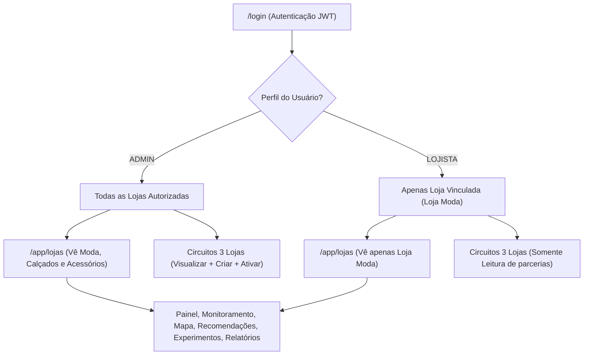

# NEXO 2031 — Inteligência Comercial Preditiva para Lojistas

[](https://fastapi.tiangolo.com)
[](https://www.python.org)
[](https://www.postgresql.org)
[](https://react.dev)
[](https://www.typescriptlang.org)
[](https://vitejs.dev)
[](https://www.docker.com)

Sistema web de inteligência comercial para shopping centers e centros comerciais, integrando análise de fluxo e circulação de clientes, mapas de calor por zonas, geração de recomendações comerciais baseadas em regras explicáveis, gestão de experimentos A/B controlados e campanhas cooperativas de três lojas (circuitos de compras).

> **Aviso de Privacidade e Dados DEMO:** Todas as métricas, contagens, posições de câmeras, fluxos espaciais e registros apresentados são agregados e sintéticos (origem `DEMO`). Em conformidade com a LGPD e as normas do projeto, não há captura de biometria, reconhecimento facial, gravação de imagens pessoais ou rastreamento individual de consumidores.

---

## 🚀 Como Rodar o Projeto

A execução de toda a aplicação (Banco de Dados PostgreSQL 16, Backend FastAPI e Frontend React/Nginx) é realizada de forma orquestrada e isolada via **Docker Compose**.

### Pré-requisitos

- [Docker Desktop](https://www.docker.com/products/docker-desktop/) instalado e em execução (suporte a Docker Engine 24+ e Docker Compose v2+).

---

### Passo 1: Configurar as Variáveis de Ambiente (`.env`)

Na raiz do repositório, crie o arquivo `.env` a partir do modelo [.env.example](.env.example):

**No Windows PowerShell:**
```powershell
Copy-Item .env.example .env
```

**No Linux / macOS (Bash):**
```bash
cp .env.example .env
```

Abra o arquivo `.env` gerado e defina os valores locais. Um exemplo pronto para desenvolvimento:

```env
POSTGRES_DB=nexo
POSTGRES_USER=nexo
POSTGRES_PASSWORD=nexo_local_dev_123
JWT_SECRET=chave_secreta_jwt_com_pelo_menos_32_bytes_para_assinatura
DEMO_ADMIN_PASSWORD=admin123
DEMO_LOJISTA_PASSWORD=lojista123
DEMO_BASE_DATE=
```

> [!IMPORTANT]
> A chave `JWT_SECRET` **precisa ter no mínimo 32 caracteres** para atender aos critérios de segurança criptográfica da API.

---

### Passo 2: Construir e Iniciar os Serviços

Execute o comando do Docker Compose na raiz do projeto:

```powershell
docker compose up --build -d
```

O Docker Compose executará automaticamente:
1. Inicialização do banco relacional **PostgreSQL 16** com volume persistente e verificação de saúde (*healthcheck*).
2. Construção da imagem do **Backend** (Python 3.12), aplicação das migrações de schema com **Alembic** (`alembic upgrade head`), carga inicial dos dados de demonstração (`python -m app.seed_demo`) e inicialização do servidor ASGI **Uvicorn** na porta `8000`.
3. Construção do bundle estático do **Frontend** (Vite + TypeScript) e disponibilização via servidor web **Nginx** na porta `5173`.

---

### Passo 3: Acessar a Aplicação

Com os contêineres iniciados, utilize os seguintes links no seu navegador:

| Serviço / Recurso | URL | Descrição |
|---|---|---|
| **Painel Web (Frontend)** | [http://localhost:5173](http://localhost:5173) | Interface principal do sistema com login e dashboards |
| **Status do Sistema** | [http://localhost:5173/status](http://localhost:5173/status) | Diagnóstico técnico público de conectividade (`/health`) |
| **Documentação da API (Swagger)** | [http://localhost:8000/docs](http://localhost:8000/docs) | Swagger UI interativo com todos os endpoints e contratos |
| **Documentação ReDoc** | [http://localhost:8000/redoc](http://localhost:8000/redoc) | Especificação de endpoints e esquemas OpenAPI |
| **Endpoint de Saúde (API)** | [http://localhost:8000/health](http://localhost:8000/health) | Resposta JSON de integridade do serviço (`status: ok`) |

---

### Passo 4: Credenciais de Acesso (Demonstração)

A tela de login conta com botões amarelos de **Acesso Rápido de Demonstração**, ou você pode digitar diretamente:

#### 1. Perfil Administrador (Gestão Global do Shopping)
- **E-mail:** `admin@demo.invalid`
- **Senha:** `admin123` (ou a senha configurada em `DEMO_ADMIN_PASSWORD`)
- **Acesso:** Permissão para alternar entre todas as lojas cadastradas e criar/gerenciar Circuitos Cooperativos de 3 Lojas.

#### 2. Perfil Lojista (Gestão da Loja Própria)
- **E-mail:** `lojista@demo.invalid`
- **Senha:** `lojista123` (ou a senha configurada em `DEMO_LOJISTA_PASSWORD`)
- **Acesso:** Acesso exclusivo à sua própria loja (*Loja Moda*), visualizando painel de vendas, mapas de calor, aceitando recomendações comerciais e gerando relatórios comparativos.

---

### Comandos Úteis do Docker Compose

- **Verificar o estado dos serviços:**
  ```powershell
  docker compose ps
  ```
- **Acompanhar os logs do backend em tempo real:**
  ```powershell
  docker compose logs -f backend
  ```
- **Acompanhar os logs de todos os contêineres:**
  ```powershell
  docker compose logs -f
  ```
- **Parar os serviços preservando os dados do banco:**
  ```powershell
  docker compose down
  ```
- **Recarregar a seed de demonstração manualmente:**
  ```powershell
  docker compose exec backend python -m app.seed_demo
  ```

---

## 👥 Visão por Perfil de Usuário

O sistema implementa controle de acesso rigoroso por papéis (**RBAC**) e por vínculos de loja (`user_stores`):



### Matriz de Telas e Permissões

| Tela | Rota | Lojista (`LOJISTA`) | Administrador (`ADMIN`) |
|---|---|:---:|:---:|
| **Seleção de Lojas** | `/app/lojas` | Apenas lojas vinculadas ao seu usuário | Todas as lojas do shopping |
| **Painel Principal (KPIs)** | `/app/lojas/:storeId/painel` | Consulta dados da loja autorizada | Consulta dados de qualquer loja |
| **Monitoramento Sintético** | `/app/lojas/:storeId/monitoramento` | Câmeras DEMO da loja autorizada | Câmeras DEMO de qualquer loja |
| **Mapa de Calor 10x8** | `/app/lojas/:storeId/mapa` | Matriz de 80 células da loja autorizada | Matriz de qualquer loja |
| **Recomendações** | `/app/lojas/:storeId/recomendacoes` | Aceitar/Descartar na sua loja | Consulta e auditoria global |
| **Experimentos Comerciais** | `/app/lojas/:storeId/experimentos` | Criação e acompanhamento de testes A/B | Gestão de testes em qualquer loja |
| **Relatórios Comparativos** | `/app/lojas/:storeId/relatorios` | Comparativo antes/depois e exportação CSV | Relatórios de qualquer loja |
| **Circuitos de 3 Lojas** | `/app/circuitos` | Leitura de circuitos participantes | Leitura e botão **`+ Novo Circuito`** |

---

## 🧩 Estrutura do Monorepo

```text
inteligencia-comercial-para-lojistas/
├── backend/                  # API REST em FastAPI / Python 3.12
│   ├── alembic/              # Migrações versionadas de banco de dados (001 a 005)
│   ├── app/                  # Código-fonte da aplicação (Routers, DTOs, Models, Services)
│   ├── tests/                # Suítes de testes: unit/, contract/ e integration/
│   ├── Dockerfile            # Imagem de produção do backend Python
│   └── requirements.lock     # Dependências com versões exatas fixadas
├── frontend/                 # Single Page Application em React 18 / TypeScript / Vite
│   ├── src/                  # Componentes, Páginas, Hooks de autenticação e API Client
│   ├── tests/                # Testes de componentes, formulários e integração (Vitest)
│   ├── Dockerfile            # Multi-stage build (Node build -> Nginx serve)
│   └── package.json          # Dependências do frontend e scripts
├── sistema/                  # Documentação normativa e de engenharia de software
│   ├── openapi.yaml          # Contrato HTTP OpenAPI normativo congelado
│   ├── 01-PRD.md             # Requisitos de Produto
│   ├── 02-ESPECIFICACAO...   # Especificação Técnica da Arquitetura
│   ├── 03-MAPEAMENTO-TELAS.md# Mapeamento visual das telas e wireframes
│   ├── 04-REGRAS-NEGOCIO.md  # Regras de negócio auditadas (RN001 a RN027)
│   └── 06-MAPA-MODULOS.md    # Fatias verticais e mapa de entregas (M00 a M08)
├── openspec/                 # Especificações de mudanças e governança OpenSpec
├── compose.yaml              # Definição dos serviços multi-container Docker Compose
├── .env.example              # Modelo de configuração de variáveis de ambiente
└── README.md                 # Este documento
```

---

## 🧪 Testes e Validação de Qualidade

O projeto conta com ampla cobertura de testes automatizados unitários, de contrato e de integração.

### 1. Testes do Backend (Python)

Para rodar os testes sem necessitar de Python instalado no host, utilize o próprio contêiner Docker:

```powershell
# Testes Unitários e de Conformidade com o Contrato OpenAPI (59 testes):
docker compose exec backend python -m pytest tests/unit tests/contract -q

# Testes de Integração com Banco de Dados PostgreSQL Real (19 testes):
docker compose exec backend python -m pytest tests/integration -q

# Verificação de Tipagem Estática:
docker compose exec backend python -m mypy

# Linting e Validação de Formatação:
docker compose exec backend python -m ruff check --no-cache .
```

### 2. Testes do Frontend (React / Vitest)

```powershell
# Executar a suíte de testes Vitest (76 testes):
npm --prefix frontend test

# Executar o linter ESLint:
npm --prefix frontend run lint

# Executar a compilação TypeScript e Build de Produção:
npm --prefix frontend run build
```

---

## 📜 Licença e Contexto Acadêmico

Projeto desenvolvido como solução de **Inteligência Comercial Preditiva com Visão Computacional** aplicada ao setor de varejo, focado na governança de dados, conformidade ética com privacidade e arquitetura limpa de software.
